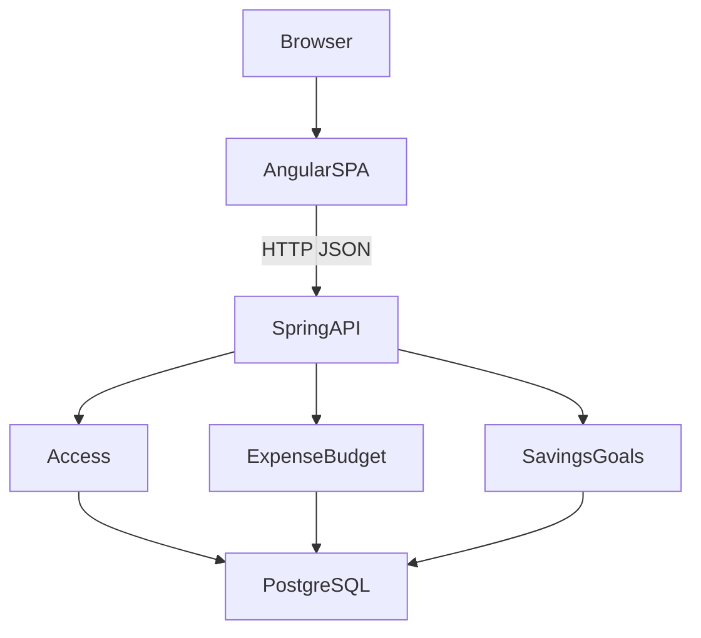
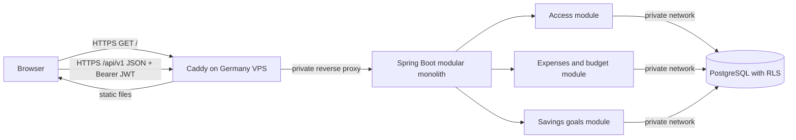

# Architecture Spine — Try Not to Be Poor

## Design Paradigm

Zwei unabhängig baubare und ausrollbare Artefakte: eine statische Angular-SPA im Browser und eine Spring-Boot-REST-API. Das Java-Artefakt ist ein Modularmonolith mit den Bereichen Zugang, Ausgaben/Budget und Sparziele. Ein gemeinsamer OpenAPI-Vertrag hält Frontend und API synchron.

## Invariants & Rules

### AD-1 — Zwei Deployables, eine Modulgrenze im Backend [ADOPTED]

- **Binds:** alle FR-1 bis FR-11
- **Prevents:** gekoppelte Frontend-/Backend-Releases und konkurrierende Zuständigkeit für Produktfunktionen.
- **Rule:** `frontend/` ist eine Angular-Client-App und wird als statische Dateien gebaut; SSR gehört nicht zu v1. `backend/` ist eine Spring-Boot-Anwendung mit den fachlichen Modulen `access`, `expense-budget` und `savings-goals`. `access` besitzt Konto- und Refresh-Daten, `expense-budget` besitzt Ausgaben und das fortlaufende Monatsbudget, `savings-goals` besitzt Sparziele. Module ändern nur ihre eigenen Daten; modulübergreifende Änderungen laufen über öffentliche Anwendungsfunktionen. Das Frontend spricht ausschließlich HTTP mit der API und greift nie direkt auf PostgreSQL zu.



### AD-2 — Versionierter REST-Vertrag [ADOPTED]

- **Binds:** FR-1 bis FR-10 und alle Browser/API-Aufrufe
- **Prevents:** unabhängig ausgerollte Clients und Server, die unterschiedliche Datenformen oder Verhalten erwarten.
- **Rule:** `api-contract/openapi.yaml` ist die gemeinsame Quelle für JSON-Anfragen, Antworten und Fehler und verwendet OpenAPI 3.0.4 unter `/api/v1`. Die ursprüngliche Vorgabe 3.2.1 wird durch 3.0.4 ersetzt, damit die festgelegte Vertragswerkzeugkette stabile OAS-3.0-Unterstützung hat. Änderungen in v1 bleiben rückwärtskompatibel; inkompatible Änderungen erhalten eine neue Hauptversion. GitHub Actions führt `openapi-generator-cli` 7.26.0 (Validierung, Angular-22-Client und Spring-Boot-4-Interfaces) sowie `oasdiff` 1.30.0 (Kompatibilitätsprüfung) bei jedem Pull Request aus. Generierte Typen und Interfaces werden mit Frontend und Backend kompiliert; inkompatible v1-Änderungen blockieren den Pull Request.

### AD-3 — Anmeldung mit kurzlebigem Access-JWT [ADOPTED]

- **Binds:** FR-1 bis FR-3
- **Prevents:** Browser- und API-Clients, die Anmeldedaten unterschiedlich speichern, erneuern oder einem Konto zuordnen.
- **Rule:** Jede Person mit dem gemeinsam geteilten Registrierungslink darf ein eigenes Konto anlegen; es gibt keine E-Mail-Einladungsliste. Konten verwenden E-Mail und Passwort; ein externer Identity-Anbieter gehört nicht zu v1. Die API stellt kurzlebige signierte Access-JWTs aus und prüft sie bei geschützten Aufrufen ohne serverseitigen Sitzungsspeicher; ihre maximale Laufzeit beträgt 15 Minuten. Angular hält das Access-JWT nur im Arbeitsspeicher und sendet es als Bearer-Token. Die API prüft Signatur, Aussteller, Zielgruppe und Ablaufzeit; `sub` ist die Nutzer-ID. Erneuerung nutzt ein rotierendes, serverseitig widerrufbares Refresh-Token in einem `HttpOnly`, `Secure`, `SameSite`-Cookie; Refresh-Token werden serverseitig nur gehasht gespeichert. Refresh und Logout haben CSRF-Schutz. Logout widerruft die aktive Refresh-Token-Familie; ein bereits ausgestelltes Access-JWT bleibt bis zum Ablauf gültig. v1 führt keine Access-Token-Sperrliste. Tokens und Finanzdaten werden nicht in `localStorage` oder `sessionStorage` abgelegt. Abmeldung, Tokenablauf und Kontowechsel verwerfen den bisherigen Finanzdaten-Arbeitsspeicher, bevor ein anderes Konto angezeigt wird. Passwörter werden mit einem adaptiven, gesalzenen Passwort-Hash gespeichert.

### AD-4 — Nutzergebundene Daten mit PostgreSQL-RLS [ADOPTED]

- **Binds:** FR-2 bis FR-10
- **Prevents:** Zugriff auf fremde Ausgaben, Budgets oder Sparziele durch vergessene Filter, manipulierte IDs oder unvollständige Abfragen.
- **Rule:** Jede nutzergebundene Finanzzeile trägt `user_id`. Der Server leitet sie ausschließlich aus dem verifizierten JWT-`sub` ab; der Client darf keine Eigentümer-ID für Lese- oder Schreibzugriffe bestimmen. Backend-Abfragen filtern zusätzlich nach dieser ID. PostgreSQL-RLS erzwingt dieselbe Grenze: vor jeder Datenoperation setzt der Server `app.user_id` transaktionslokal aus dem verifizierten `sub`; fehlender Kontext verweigert Zugriff. RLS ist auf nutzergebundenen Tabellen erzwungen. Die Laufzeitrolle ist weder Tabellenbesitzer noch Superuser und besitzt kein `BYPASSRLS`. Zugangsdaten und Refresh-Token-Metadaten sind nur über das Zugangsmodul zugänglich.

### AD-5 — Gemeinsame Geld- und Kalendersemantik [ADOPTED]

- **Binds:** FR-4 bis FR-10
- **Prevents:** Rundungsfehler und unterschiedliche Monats- oder Erfassungsdaten zwischen Browser, Java und PostgreSQL.
- **Rule:** Geldwerte sind ganzzahlige Euro-Cent (`amountCents`), nie binäre Gleitkommazahlen; v1 verwendet ausschließlich EUR. Der technische Wertebereich ist für alle gespeicherten Geldfelder und berechneten Cent-Ergebnisse `-9007199254740991` bis `9007199254740991`: JSON, Java-Validierung und PostgreSQL-`BIGINT`-Constraints erzwingen ihn für gespeicherte Einzelwerte. Die API berechnet Monatssummen und Restbudget mit exakter Arithmetik und weist jede Mutation zurück, die einen gespeicherten oder berechneten Cent-Wert außerhalb dieses Bereichs erzeugen würde. Nur Werte innerhalb des Bereichs werden als JSON-Zahl ausgegeben. Welche Vorzeichen und engeren Produktlimits pro Feld zulässig sind, bleibt separat festzulegen. Erfassungsdatum ist ein ISO-Datum (`YYYY-MM-DD`/`DATE`), das der Server anhand `Europe/Berlin` setzt. Ein optionales Sparziel-Zieldatum ist ein Kalenderdatum (`YYYY-MM-DD`, OpenAPI `format: date`, Java `LocalDate`, PostgreSQL `DATE`) und wird unverändert gespeichert und zurückgegeben; es wird nicht als Zeitpunkt umgerechnet. Monatsgrenzen und Restbudget verwenden denselben Berlin-Kalender. Die eigene Ausgabenliste enthält alle Monate mit Name, Betrag und Erfassungsdatum; nur die Restbudgetformel summiert den laufenden Monat: `Monatsbudget − eigene Monatsausgaben`. Ein negatives Ergebnis bleibt numerisch erhalten; seine Darstellung wird vor der UI-Umsetzung bestätigt. Pro Nutzer gilt ein fortlaufender Budgetbetrag über Monatsgrenzen hinweg, bis er geändert wird; es gibt in v1 keine getrennten Monatsbudgets. Sparziel-Fortschritt ersetzt den bisherigen Gesamtbetrag und erzeugt keinen Beitragsverlauf.

### AD-6 — Ein deutscher Produktionshost mit privatem Datenbanknetz [ADOPTED]

- **Binds:** alle FR-1 bis FR-11 und der Produktionsbetrieb
- **Prevents:** öffentlich erreichbare Datenbank/API-Ports, getrennte Cookie- und API-Ursprünge sowie nicht reproduzierbare Einzeldeployments.
- **Rule:** Produktion läuft zunächst auf einem selbstverwalteten VPS in Deutschland; Hetzner Cloud in Falkenstein oder Nürnberg ist die gewählte Zieloption. Docker Compose betreibt Caddy, Spring-API und PostgreSQL. Caddy ist der einzige öffentliche Web-Einstieg, terminiert HTTPS, liefert das statische Angular-Build aus und leitet `/api/v1` an die API weiter. API und Datenbank bleiben im privaten Compose-Netz; nur Caddy bindet öffentliche Ports. Lokale Entwicklung verwendet einen Frontend-Proxy für denselben `/api/v1`-Pfad. Produktionsgeheimnisse liegen außerhalb des versionierten Quelltexts. Vor echten Nutzerdaten müssen verschlüsselte Backups außerhalb des VPS und ein getesteter Wiederherstellungsweg vorhanden sein. v1 akzeptiert den Einzelhost als gemeinsame Ausfall- und Wartungsdomäne.

## Consistency Conventions

| Concern | Convention |
| --- | --- |
| Modulzuständigkeit | Pakete und Daten werden den Bereichen `access`, `expense-budget` und `savings-goals` zugeordnet; andere Module ändern sie nur über öffentliche Anwendungsfunktionen. |
| API- und Datenformate | OpenAPI definiert die HTTP-Form. Geld ist ganzzahlig in Euro-Cent; Datum ist `YYYY-MM-DD` nach `Europe/Berlin`; Eigentümer-IDs stammen serverseitig aus dem JWT. |
| Zustandsänderung | PostgreSQL ist maßgebliche Quelle. Schreibvorgänge laufen serverseitig in Datenbanktransaktionen; das Frontend behandelt Finanzdaten nur im Arbeitsspeicher und verspricht keine Offline-Synchronisierung. |
| Datenbankschema | Schemaänderungen werden über versionierte Migrationen eingeführt; automatische Schemaerzeugung ist in Produktion aus. |
| Fehler | HTTP-Status und JSON-Fehlerformen sind im OpenAPI-Vertrag festgelegt. Fremde und nicht vorhandene Ressourcen legen keine Existenz fremder Datensätze offen. |

## Stack

Versionen am 2026-10-19 gegen offizielle Projektquellen geprüft.

| Name | Version |
| --- | --- |
| Angular | [22.2.3](https://www.npmjs.com/package/@angular/core?activeTab=versions) |
| Node.js, Build | [24.22.0 LTS](https://nodejs.org/en/blog/release) |
| Spring Boot | [4.1.1](https://docs.spring.io/spring-boot/system-requirements.html) |
| Java | [25 LTS](https://www.oracle.com/java/technologies/java-se-support-roadmap.html) |
| Maven-Distribution über Maven Wrapper | [3.10.0](https://maven.apache.org/download.cgi) |
| PostgreSQL | [18.6](https://www.postgresql.org/support/versioning/) |
| OpenAPI Specification | [3.0.4](https://spec.openapis.org/oas/v3.0.4.html) |
| Docker Engine | [29.9.1](https://docs.docker.com/engine/release-notes/29/) |
| Docker Compose | [5.6.0](https://github.com/docker/compose/releases/latest) |
| Caddy | [2.11.7](https://github.com/caddyserver/caddy/releases/latest) |

## Structural Seed



```text
/
  frontend/                 Angular-SPA; static build artifact
  backend/                  Spring-Boot-API; modular monolith artifact
  api-contract/openapi.yaml Shared, versioned HTTP contract
  deploy/                   Docker Compose, Caddy and host configuration
```

## Capability → Architecture Map

| Capability / Area | Lives in | Governed by |
| --- | --- | --- |
| FR-1 Kontozugang | `backend/access`, Angular-Zugang | AD-1, AD-2, AD-3 |
| FR-2 bis FR-3 Datentrennung | API-Autorisierung, PostgreSQL-RLS | AD-3, AD-4 |
| FR-4 bis FR-6 Ausgaben | `backend/expense-budget`, Angular-Monatsübersicht | AD-2, AD-4, AD-5 |
| FR-7 bis FR-8 Monatsbudget | `backend/expense-budget`, Angular-Monatsübersicht | AD-2, AD-4, AD-5 |
| FR-9 bis FR-10 Sparziele | `backend/savings-goals`, Angular-Sparziele | AD-2, AD-4, AD-5 |
| FR-11 Responsive Website | Angular-SPA, Caddy | AD-1, AD-6 |

## Deferred

- Vor Verteilung des Registrierungslinks: Gültigkeitsdauer, Erneuerung und Widerruf des privaten Links festlegen.
- Vor echten Finanzdaten: Anforderungen an Export, Löschung, Aufbewahrung, Kontowiederherstellung und E-Mail-Bestätigung festlegen.
- Vor Eingabeabnahme: zulässige Betragsgrenzen und Vorzeichen, Fortschritt über dem Sparziel sowie Bearbeiten und Löschen bestehender Sparziele festlegen. Die PRD-Annahme, dass Budgetänderungen sofort gelten, bestätigen.
- Vor der Umsetzungsplanung: negative Restbudgetdarstellung bestätigen und die in der UX aufgeführten Smartphone-/Desktop-Viewports samt Kernaufgaben als Prüfpunkte festlegen.
- Vor Authentifizierungsstories: die konkrete Access-JWT-Laufzeit innerhalb des 15-Minuten-Maximums, Refresh-Laufzeit und -Wiederverwendung sowie die konkrete CSRF-Mechanik festlegen.
- Vor Produktionsdaten: VPS-Größe, Domain/DNS, Backup-Ziel, Häufigkeit, Aufbewahrung, Wiederherstellungsziele und Monitoring festlegen.
- Erledigt: OpenAPI-Vertragswerkzeuge und CI/CD sind auf OpenAPI Generator 7.26.0, oasdiff 1.30.0 und GitHub Actions festgelegt. OAS 3.0.4 ersetzt 3.2.1; damit sind Angular 22 und Spring Boot 4.1.1 durch dokumentierte Generatoroptionen abgedeckt. API- und Client-Änderungen müssen die AD-2-Prüfungen bestehen. Die konkrete Persistenzbibliothek bleibt code-owned.
