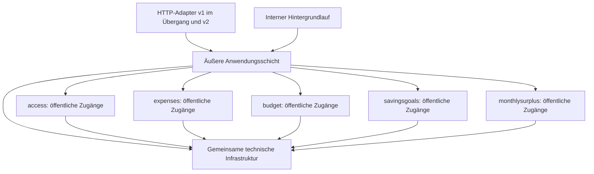
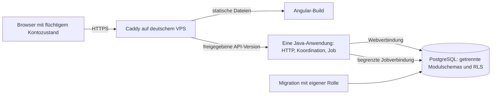

# Architecture Spine — Try Not to Be Poor

## Design Paradigm

Eine statische Angular-SPA und eine Spring-Boot-API bleiben zwei unabhängig baubare und ausrollbare Artefakte. Das Java-Artefakt ist ein modularer Monolith mit fünf isolierten fachlichen Modulen und einer äußeren Anwendungsschicht für gemeinsame Anwendungsfälle. PostgreSQL bleibt die gemeinsame Transaktionsgrenze; die Monatsverarbeitung läuft in derselben Java-Anwendung.

Diese Spine beschreibt die noch umzusetzende Zielarchitektur. Der Bestand verwendet weiterhin API v1 und das gemeinsame Modul expense-budget. Die neue Spec und Linus’ Entscheidungen vom 2026-10-25 ersetzen die betroffenen bisherigen Regeln; abgeschlossene Storyabnahmen bleiben historische Nachweise. Entscheidungen AD-1 bis AD-6 behalten ihre IDs.

## Invariants & Rules

### AD-1 — Fünf Module mit eigenem Datenbesitz [ADOPTED]

- **Binds:** FR-1 bis FR-11, CAP-2, CAP-4, sämtliche Backend-Anwendungsfälle.
- **Prevents:** gemeinsame Ausgaben-/Budgetzuständigkeit, konkurrierende Datenbesitzer und zyklische Modulabhängigkeiten.
- **Rule:** Das einzelne Java-Artefakt enthält access, expenses, budget, savingsgoals und monthlysurplus. Jedes Modul besitzt seine Tabellen, internen Datenzugriffe und schmalen öffentlichen Anwendungs-/Lesezugänge. Geschwistermodule importieren weder einander noch die äußere Anwendungsschicht. Sie lesen und schreiben ausschließlich eigene Tabellen; modulübergreifende SQL-Abfragen und Zugriffe auf fremde Repositories sind ausgeschlossen. Die äußere Anwendungsschicht koordiniert ausschließlich öffentliche Modulzugänge und besitzt keine fachlichen Finanzdatensätze. HTTP- und Jobadapter rufen diese Anwendungsfälle auf. Gemeinsame technische Infrastruktur enthält Geld-/Kalenderregeln, Ausführungskontext und Transaktionszugang, keine fachlichen Daten oder Abläufe.

| Modul | Eigene Daten | Öffentliche Verantwortung |
| --- | --- | --- |
| access | Konten, Passwort- und Refresh-Metadaten | Registrierung, Sitzungen, verifizierte Identität |
| expenses | Ausgaben einschließlich Eigentümer und Erfassungsdatum | Eigene Ausgaben verwalten, exakte Summe eines angegebenen Monats liefern |
| budget | Fortlaufendes Budget und monatswirksame Budgetstände | Budget ändern, den für einen angegebenen Monat gültigen Betrag oder fehlendes Budget liefern |
| savingsgoals | Sparziele und tatsächlicher Gesamtfortschritt | Zielverwaltung, absoluten Fortschritt ersetzen, eine geprüfte Differenz atomar anwenden |
| monthlysurplus | Erstaktivierungsmonat, Zielauswahlhistorie, Monatsnachweise, Vormerkungen und Verarbeitungsmetadaten | Monatswirkung und Zielbindung bestimmen, Vormerkungen übernehmen, verbrauchte Zuordnungen bewahren |

### AD-2 — Vollständige API v2 mit Vertrag je Hauptversion [ADOPTED]

- **Binds:** sämtliche Browser/API-Aufrufe, CAP-1 bis CAP-4, Vertragswerkzeuge und CI.
- **Prevents:** negative Fortschrittsantworten unter dem nichtnegativen v1-Vertrag und auseinanderlaufende Clients/Server.
- **Rule:** Alle Bereiche einschließlich Zugang wechseln für die neue Oberfläche vollständig auf /api/v2. OpenAPI 3.0.4 bleibt die gemeinsame Quelle: api-contract/openapi.yaml ist der eingefrorene v1-Vertrag, api-contract/v2/openapi.yaml der v2-Vertrag. Jede unterstützte Hauptversion wird separat validiert, gegen ihren eigenen Basisvertrag auf Kompatibilität geprüft und in getrennte Java-/TypeScript-Namensräume generiert und kompiliert. Der erstmalige v2-Vertrag wird als Erstvertrag geprüft; v1 und v2 werden nicht als kompatible Revisionen desselben Vertrags verglichen. OpenAPI Generator 7.26.0 und oasdiff 1.30.0 bleiben die Werkzeugbasis. Inkompatible Änderungen innerhalb einer weiter unterstützten Hauptversion blockieren CI. Der Ablöse- und Freigabeablauf aus AD-10 ist verbindlich. Pfade, DTOs und Fehler werden vor paralleler API-/Frontend-Arbeit im v2-Vertrag festgelegt.

### AD-3 — Kontozugang und flüchtiger Browserzustand [ADOPTED]

- **Binds:** FR-1 bis FR-3, HTTP-Zugriffe beider Versionen während des Übergangs.
- **Prevents:** unterschiedlich gespeicherte Sitzungen und Sichtbarkeit des vorherigen Kontobestands.
- **Rule:** Der geteilte Registrierungslink erlaubt eigene Konten mit E-Mail und Passwort. Die im Bestand festgelegte Linkgültigkeit, Rotation und Sperrung gelten fort. Passwörter verwenden den bestehenden adaptiven gesalzenen Hash. Geschützte HTTP-Aufrufe prüfen signierte Access-JWTs einschließlich Aussteller, Zielgruppe und Ablauf; sub bestimmt das Nutzerkonto. Access-JWTs gelten gemäß der konkretisierten Epic-/Story-Abnahme 10 Minuten und liegen ausschließlich im Angular-Arbeitsspeicher. Refresh nutzt rotierende, serverseitig gehashte und widerrufbare Tokens im HttpOnly-/Secure-/SameSite=Strict-Cookie; CSRF- und genaue Origin-Prüfung von Refresh/Logout gelten auch in v2. Die bestehende Refresh-Grenze von 30 Tagen Inaktivität beziehungsweise 90 Tagen seit Anmeldung bleibt erhalten. Wiederverwendung eines ersetzten Refresh-Tokens widerruft die Token-Familie. Logout widerruft die Refresh-Familie; bereits ausgestellte Access-JWTs gelten höchstens bis zu ihrem Ablauf, ohne neue Sperrliste. Logout, Tokenablauf und Kontowechsel verwerfen Finanzdaten und verhindern die Übernahme verspäteter Antworten. Tokens und Finanzdaten werden weder in localStorage noch sessionStorage gespeichert. Die weiteren unveränderten Zugangsabnahmen aus den Epics bleiben verbindlich.

### AD-4 — Getrennte Web-/Jobautorisierung unter erzwungener RLS [ADOPTED]

- **Binds:** FR-2 bis FR-10, CAP-4, sämtliche nutzergebundenen Finanzdaten und Datenbankverbindungen.
- **Prevents:** fremde Kontokontexte aus HTTP-Eingaben, Finanzzugriff ohne Kontext und weitreichende Jobberechtigungen.
- **Rule:** Jede Finanzzeile trägt user_id. Bei HTTP stammt der Kontokontext ausschließlich aus verifiziertem JWT-sub. Beim Hintergrundlauf stammt er aus der serverseitig gespeicherten Automatikaktivierung; vor fachlicher Verarbeitung wird diese im gesperrten Kontokontext erneut geprüft. Pro Transaktion wird genau ein Konto durch transaktionslokales app.user_id gesetzt; fehlender Kontext verweigert Finanzzugriffe. Abfragefilter und erzwungene PostgreSQL-RLS prüfen dieselbe Identität. tnbp_runtime und tnbp_monthly_worker sind getrennte, ausdrücklich gebundene Verbindungs-/Transaktionskontexte im selben Prozess. Beide Rollen sind weder Tabellenbesitzer noch Superuser, besitzen kein BYPASSRLS und können nicht in Migrations-/Besitzerrollen wechseln. Zugangsdaten der Rollen liegen außerhalb versionierter Dateien.

| Rolle | Erlaubter Umfang |
| --- | --- |
| tnbp_runtime | Web-Anwendungsfälle; Finanzdaten ausschließlich unter dem JWT-Konto, Zugangsdaten nur über access; keine globale Jobermittlung |
| tnbp_monthly_worker | Benötigte Budget-/Ausgabespalten lesen, Zielidentität/Fortschritt lesen und nur progress_cents ändern, eigene Monatsnachweise und technische Fälligkeit bearbeiten; keine Passwort-/Sitzungsdaten, keine Anlage/Löschung von Ausgaben oder Sparzielen und keine nutzergesteuerte Zielauswahl |
| tnbp_migrator | Versionierte Migrationen; keine Verwendung durch HTTP oder Hintergrundverarbeitung |

Die kontoübergreifende Jobermittlung liegt ausschließlich beim Modul monthlysurplus. Eine nur der Jobrolle ausführbare Discovery-Funktion liefert begrenzte Pakete aus Konto-ID und technischer Fälligkeit, keine Finanzwerte oder Zugangsdaten. Ihr SECURITY-DEFINER-Eigentümer ist eine gesonderte NOLOGIN-Rolle ohne Tabellenbesitz/BYPASSRLS; eine explizite RLS-Lesepolicy erlaubt ihr nur die erforderlichen aktivierten Automatikzeilen. Fester sicherer search_path, qualifizierte Objektnamen und entzogene PUBLIC-Ausführungsrechte sind Pflicht. Diese Ausnahme zur Ermittlung erlaubt keinen kontoübergreifenden Zugriff auf Ausgaben, Budgets oder Ziele. Es gibt keinen öffentlichen Jobendpunkt und keine simulierten Nutzer-JWTs. Start- und Integrationstests prüfen Rollen, Policies, fehlende/fremde Kontexte und Kontextfreiheit wiederverwendeter Verbindungen.

### AD-5 — Exakte Geld- und Kalendersemantik [ADOPTED]

- **Binds:** FR-4 bis FR-10, CAP-1, CAP-4, API, Java, PostgreSQL und Darstellung.
- **Prevents:** Rundungsfehler, abgeschnittene Korrekturen und unterschiedliche Monatszuordnungen.
- **Rule:** EUR-Cent bleiben exakte Ganzzahlen im sicheren Bereich −9007199254740991 bis +9007199254740991. Gespeicherte Werte und fachliche Cent-Ergebnisse einschließlich Summen, Restbudget, Vormerkung und Fortschritt werden vor Commit beziehungsweise Ausgabe gegen diese Grenzen geprüft; Zwischenrechnungen bleiben exakt. Überschreitende Mutationen und Übernahmen werden vollständig abgelehnt. Ausgaben und Zielbeträge sind positiv; Budget und Monatssummen nichtnegativ. Sparfortschritt und Restbudget dürfen negativ sein. Manuelle Geldangaben mit mehr als zwei Euro-Nachkommastellen werden abgelehnt. Betrag und Prozentwert zeigen den tatsächlichen Sparfortschritt, auch unter null oder über dem Ziel; nur der Balken wird auf 0 bis 100 % begrenzt.

Erfassungsdatum und Monatsgrenzen verwenden weiterhin Europe/Berlin. Ausgabedatum ist serverseitig gesetzt und bei Bearbeitung unverändert. Kalenderdaten einschließlich optionalem Zieldatum bleiben ISO-Daten ohne Umrechnung in Zeitpunkte. Das Budget gilt ab seinem Wirksamkeitsmonat fort; eine Änderung betrifft den laufenden und folgende Monate, nicht abgeschlossene Budgetstände. Die Historie enthält Ausgaben aller Monate. Restbudget bleibt ausschließlich gültiges Monatsbudget minus eigene laufende Monatsausgaben; bei fehlendem Budget ist es nicht berechenbar. Sparanrechnungen erzeugen keine Ausgabe und verändern diese Formel nicht.

### AD-6 — Einzelhost und gemeinsame betriebliche Grenze [ADOPTED]

- **Binds:** FR-1 bis FR-11, CAP-4, Deployment und Umgebungen.
- **Prevents:** zusätzlicher unkoordinierter Jobdienst, öffentliche Datenbank/API-Ports und verstreute Produktionsgeheimnisse.
- **Rule:** Zielbetrieb bleibt ein selbstverwalteter VPS in Deutschland mit Hetzner Cloud als gewählter Option. Docker Compose betreibt Caddy, das eine Java-Artefakt einschließlich Hintergrundlauf und PostgreSQL. Caddy ist der einzige öffentliche Einstieg, liefert das statische Angular-Build und routet die gemäß AD-10 freigegebenen API-Versionen. API und Datenbank bleiben im privaten Compose-Netz. Lokale Entwicklung und Tests verwenden getrennte Konfigurationen und denselben API-Pfad über den Frontend-Proxy. Der Job verwendet denselben Datenbestand und dieselben öffentlichen Modulfunktionen wie HTTP. Produktionsdaten erfordern weiterhin verschlüsselte externe Backups und einen getesteten Wiederherstellungsweg. Der Einzelhost bleibt gemeinsame Ausfall-/Wartungsdomäne; ein Ausfall wird durch AD-9 nachgeholt.

### AD-7 — Atomare Koordination und einheitliche Kontoserialisierung [ADOPTED]

- **Binds:** alle Finanzmutationen, Monatsansicht, CAP-2, CAP-4, Web- und Jobzugang.
- **Prevents:** Teilbestätigungen, verlorene Fortschrittsänderungen und auseinanderlaufende Budget-/Ausgabesnapshots.
- **Rule:** Die äußere Anwendungsschicht eröffnet die Transaktion und bindet vor Modulzugriff den Web- oder Jobkontext. Alle beteiligten Modulfunktionen teilen dieselbe physische Verbindung/Transaktion; eigenständige innere Commits, ein Kontextwechsel oder eine Verbindung der anderen Rolle sind ausgeschlossen. Erfolg wird erst nach dem äußeren Commit bestätigt. Fehler einschließlich Grenzüberschreitung rollen den gesamten Anwendungsfall zurück.

Jede Mutation von Ausgaben, Budget, Zielen, Fortschritt, Automatik oder Monatsnachweisen erwirbt vor zustandsabhängigem Lesen dieselbe transaktionsgebundene Kontosperre, auch bei leeren Konten. Ein zentraler technischer Sperrzugang verwendet den bestehenden PostgreSQL-Advisory-Schlüssel aus der kanonischen Konto-UUID und Hash-Seed 14. Web- und Jobverbindungen teilen diesen Schlüssel. Unter READ COMMITTED werden Fachzustand und Aktivierung nach Sperrerwerb gelesen. Jeder Anwendungsfall erhält genau einen fachlichen Zeitpunkt und daraus abgeleiteten Europe/Berlin-Monat; bei Mutationen wird dieser nach Sperrerwerb erfasst, bei reinen Leseansichten einmal vor den Teilabfragen. Die Koordination übergibt denselben Zeitpunkt/Monat an alle öffentlichen Modulzugänge; diese bestimmen den laufenden Monat innerhalb dieses Anwendungsfalls nicht erneut. Erfassungsdatum und Wirksamkeitsmonat verwenden diesen gemeinsamen Kontext. Zusammengesetzte Monats-/Automatikansichten lesen auf einer gemeinsamen read-only REPEATABLE-READ-Verbindung. Das bisherige gemeinsame SQL über Ausgaben und Budget entfällt.

### AD-8 — Dauerhafter Monatsnachweis und historische Zielbindung [ADOPTED]

- **Binds:** CAP-4, Erstaktivierung, Monatsabschluss, Vormerkungen und Ziel-Lebenszyklus.
- **Prevents:** Doppelanrechnung, rückwirkender Einsatz heutiger Budget-/Zielstände und Wiederverwendung gelöschter Zielanrechnungen.
- **Rule:** monthlysurplus speichert den unveränderlichen Erstaktivierungsmonat, die monatswirksame Zielauswahlhistorie und höchstens einen wirksamen Nachweis je user_id/Herkunftsmonat mit Datenbank-Eindeutigkeit. Die Berechnungsbasis ist der über budget gelesene historisch gültige Betrag und die über expenses gelesene exakte Ausgabensumme dieses Monats. Bei gesetztem Budget gilt Überschuss = max(0, Budget − Ausgaben). Monate vor Aktivierung bleiben ausgeschlossen. Auswahländerungen betreffen den offenen und spätere Monate; der Abschluss verwendet die Auswahl zum Ende des Herkunftsmonats.

| Nachweiszustand | Dauerhafte Bedeutung |
| --- | --- |
| Ohne Budget | Monat geprüft; keine erfundene Vormerkung oder Anrechnung |
| Vorgemerkt | Noch keinem Ziel zugeordneter Monatsüberschuss |
| Zugeordnet | Herkunftsmonat und Ziel-ID gebunden; zuletzt berücksichtigter Überschuss gespeichert |
| Ziel gelöscht | Ursprüngliche Zuordnung verbraucht; keine Übertragung oder neue Vormerkung |

Technische Präzisierung für spätere Differenzkorrekturen: Auch Nullüberschüsse mit gesetztem Budget bewahren die historische Auswahl. Ohne Auswahl bleiben solche Nachweise offen; eine spätere Übernahme bindet alle offenen Nachweise mit Budget einschließlich Nullbeträgen an das ausgewählte Ziel. Das verändert um null keinen Fortschritt, hält aber das Ziel späterer Korrekturen eindeutig. Ohne Budget entsteht dadurch keine Vormerkung.

Vor Zielauswahl/-wechsel werden unter der Kontosperre fällige Monate anhand ihrer historischen Auswahl nachgeholt. Auswahl eines eigenen vorhandenen Ziels übernimmt anschließend alle noch offenen Vormerkungen vollständig und genau einmal; Nachweise und Fortschritt committen gemeinsam. Zielanlage wählt kein Ziel automatisch aus.

Ziellöschung benötigt keinen vorgelagerten Nachhollauf: Sie entfernt Ziel/Fortschritt und sichert in derselben Kontotransaktion bestehende Zuordnungen sowie noch unbearbeitete abgeschlossene Monate mit historischer Monatsendeauswahl dieses Ziels dauerhaft als verbraucht. Ein eigener Löschmarker des Überschussmoduls zusammen mit der erhaltenen Auswahlhistorie darf diese Wirkung repräsentieren. Der entfallende Fortschritt wird vorher nicht noch erhöht; fällige Monate anderer Ziele bleiben unabhängig nachholbar. Eine aktive Auswahl wird für den offenen Monat geleert. Historische Ziel-IDs/Nachweise bleiben erhalten: kein Lösch-Cascade und kein SET NULL auf der Herkunftszuordnung. Unzugeordnete Vormerkungen bleiben erhalten; weitere Monate ohne gültiges Ziel werden vorgemerkt. Die Details der Zustandsrepräsentation gehören ausschließlich monthlysurplus.

### AD-9 — Differenzkorrekturen und nachholbarer Hintergrundlauf [ADOPTED]

- **Binds:** CAP-4, historische Ausgabenänderungen, manuelle Fortschritte, Neustarts und Parallelverarbeitung.
- **Prevents:** Rekonstruktion über manuelle Eingaben hinweg, verlorene Nachholläufe und blockierte fremde Konten.
- **Rule:** Eine historische Betragsänderung oder Löschung einer Ausgabe berechnet in derselben Transaktion die Wirkung des betroffenen aktivierten, abgeschlossenen Monats neu. Ohne Nachweis wird dieser anhand AD-8 erstmals abgeschlossen. Bei Vormerkung wird nur der Monatsbetrag ersetzt; bei zugeordnetem noch vorhandenem Ziel wird ausschließlich neuer minus zuletzt berücksichtigter Überschuss auf dessen aktuellen Gesamtfortschritt angewendet. Ziel gelöscht bleibt verbraucht und erzeugt keine neue Wirkung. Nachweisaktualisierung und Fortschrittsdifferenz sind atomar. Eine reine Namensänderung erzeugt keine finanzielle Korrektur.

Manuelle Fortschrittseingabe ersetzt weiterhin den aktuellen Gesamtbetrag ohne Löschen technischer Monatsmetadaten; sie muss auch bei einem wegen Betragsgrenzen blockierten Nachhollauf möglich bleiben. Automatische Differenzen werden auf den danach maßgeblichen gesperrten Gesamtbetrag angewendet, nie durch Zurückschreiben eines zuvor gelesenen Gesamtwerts. Negativwerte bleiben erhalten.

Der interne Hintergrundlauf prüft nach erfolgreichem Start und regelmäßig gespeicherte fällige Monate, einschließlich aller versäumten Monate ab Aktivierung. Er arbeitet mit begrenzten Paketen, je Konto eigener Transaktion/Kontosperre und chronologischer Monatsverarbeitung. Einmalwirkung beruht auf Nachweis und Transaktion, nicht auf einem einmaligen Uhrzeittrigger oder nur lokaler Prozesssperre. Konkurrenz oder Wiederholung liest den bereits wirksamen Nachweis. Fehler verändern keine wirksamen Beträge/Zuordnungen; nach Rollback dürfen ausschließlich technische Fehler-/Wiederholungsmetadaten separat gespeichert werden. Verzögerte Wiederholung und faire Kontowahl lassen andere Konten weiterlaufen. Beobachtbar sind Rückstand, letzte erfolgreiche Verarbeitung und technische Fehlerkategorien; Beträge, Tokens und personenbezogene Finanztexte gehören nicht in Logs.

### AD-10 — Vertragswechsel, Datenmigration und Browseransichten [ADOPTED]

- **Binds:** vollständiger v2-Übergang, CAP-1 bis CAP-4, bestehende Konten/Daten und neue Implementierungsstories.
- **Prevents:** stiller v1-Bruch, Datenverlust beim Modulschnitt und Freigabe der Automatik vor vollständigem Versionswechsel.
- **Rule:** Die Umsetzung erfolgt mit neuen Flyway-Migrationen. Ausgaben und Budget erhalten getrennte modulseigene Schemas/Datenzugriffe; IDs, Eigentümer, Ausgabedaten und historische Budgetstände bleiben erhalten. Bestehende Migrationen werden nicht geändert. Neue Monatsnachweise werden nicht für Monate vor Aktivierung erzeugt; bestehender manueller Fortschritt wird nicht als Monatsanrechnung rekonstruiert.

Der geplante Übergang umfasst diese verbindliche Reihenfolge:

1. V2-Vertrag, neue Modulzugänge, Migrationen, Rollen und Generatoren bereitstellen. Neue Rollen benötigen auch bei bereits initialisierten Datenbankvolumes einen wiederholbaren administrativen Provisionierungsschritt; das Erstanlage-Skript allein reicht nicht. Der Migrator bleibt ohne CREATEROLE, Web-/Jobrollen bleiben unprivilegiert. Solange v1 unterstützt ist, bleiben Antworten und zulässige Schreibvorgänge v1-kompatibel; die neue Automatik und manuelle negative Fortschrittswerte sind serverseitig gesperrt.
2. Sämtliche v2-Routen einschließlich Anmeldung/Refresh/Logout, Security-/CSRF-/Origin-Regeln, no-store, Proxy, Interceptor und vollständige v2-Oberfläche prüfen. Parallel angebotene v1-Adapter verwenden dieselbe neue Koordination/Kontosperre. Die Übergangsprüfung belegt auch, dass v1 keine negativen Antworten erhält.
3. V1 nach dem dokumentierten Ablöseplan kontrolliert stilllegen und neue v1-Zugriffe abweisen. Alle bereits laufenden v1-Anwendungsfälle einschließlich GETs und ihrer Datenbankarbeit müssen abgeschlossen oder abgebrochen sein; kein zuvor zugelassener v1-Read darf erst nach der Freigabe signierter Werte Finanzdaten laden. Veraltete Frontends erhalten einen Aktualisierungspfad. Erst nach dieser versionsübergreifenden Barriere die v2-Funktionen für signierten Fortschritt und die aktivierbare Automatik freigeben. Die tatsächliche Automatik beginnt weiterhin erst mit der nutzerbezogenen Aktivierung.
4. Vor Freigabe ist eine Rücknahme nur auf einen gegen den migrierten Schema-/Rollenzustand geprüften, v1-kompatiblen Release zulässig. Nach ersten signierten Werten oder Monatswirkungen ist ein Rückfall auf v1 ausgeschlossen; Fehler werden durch v2-kompatiblen Fix beziehungsweise geprüfte Wiederherstellung behandelt. Daten werden für einen Code-Rollback weder abgeschnitten noch überschrieben.

Die Angular-Hauptbereiche sind Monat, Ausgaben und Sparziele; Monat bleibt Startansicht. Ausgaben einschließlich Historie/Bearbeiten/Löschen liegen im eigenen Bereich. Nach bestätigter Ausgabenmutation lädt die nächste Monatsansicht ihren konsistenten Stand neu. Gemeinsame Sitzungs-/Generationskontrollen verwerfen späte Antworten nach Sitzungsende/Kontowechsel. Alle angemeldeten Hauptbereiche bieten dieselbe zugängliche rote Abmeldeaktion. Systemseitige Zeitzonenerläuterungen entfallen; der interne Kalender und nutzereigene Texte bleiben unverändert. Automatikaktivierung, Zielauswahl, Vormerkung und tatsächlicher negativer Fortschritt bleiben verständlich und zugänglich sichtbar. Entwürfe bleiben bei Fehlern ausschließlich im offenen Tab, Doppelsenden wird verhindert, Ausgabe-/Ziellöschung benötigt eine UI-Bestätigung; die Ziellöschung erklärt auch Fortschrittsverlust und weitere Vormerkungen.

Der bestehende UX-Prüfmaßstab aus DESIGN/EXPERIENCE und den konkretisierten Storyabnahmen gilt für alle neuen Zustände: WCAG 2.2 AA als Prüfziel, vollständige Tastaturbedienung und sichtbarer Fokus, programmatische Labels/Statusmeldungen, 200-%-Text und Reflow bei 320 CSS-Pixeln. Die bisherigen Viewports 320×568, 390×844, 768×1024 und 1280×800 sowie mindestens 44-Pixel-Aktionen und 48-Pixel-Geldfelder werden weiter geprüft.

## Consistency Conventions

| Concern | Convention |
| --- | --- |
| Öffentliche Modulzugänge | Eigentümermodul definiert Projektionen und Befehle; technische Ausführung erfolgt im gebundenen äußeren Transaktionskontext. Kein Export interner Repositorytypen. |
| Kontokontext | JWT-basierter Webkontext und aktivierungsbasierter Jobkontext werden vor Fachzugriff unterschieden; kein Eigentümer aus Finanzrequestfeldern. |
| Schema und Herkunft | Ein Modul besitzt seine Daten; historische Zielreferenzen überleben die Ziellöschung als Werte/Nachweise im Überschussmodul. |
| API | OpenAPI vor Verbraucherimplementierung; Fehlerformen, Nullable-Semantik und Grenzen verbindlich im jeweiligen Versionsvertrag. Fremde/nicht vorhandene Ressourcen verraten keine Fremddatenexistenz. |
| Prüfpflichten | Modulabhängigkeiten und Schemaeigentum prüfen; echte PostgreSQL-Tests für Rollen, gemeinsamen Rollback, konkurrierende Web-/Jobzugriffe und Monatsnachweise. Browserprüfung für v2-Übergang, drei Hauptbereiche, negative Anzeige, Entwurfs- und Sitzungsgrenzen. |

## Stack

Repositorypins am 2026-10-25 abgeglichen; keine Versionsaktualisierung durch diese Änderung. Die Produktionswerkzeuge sind der unveränderte Planungsseed vom 2026-10-19 und vor dem ersten Produktionsrollout erneut zu prüfen.

| Name | Version | Grundlage |
| --- | --- | --- |
| Angular | 22.2.3 | frontend/package.json |
| Node.js | 24.22.0 | frontend/package.json, CI |
| Spring Boot | 4.1.1 | backend/pom.xml |
| Java | 25 LTS | backend/pom.xml, CI |
| Maven Wrapper-Distribution | 3.10.0 | backend/.mvn/wrapper/maven-wrapper.properties |
| PostgreSQL | 18.6 | lokales Compose, Integrationstest-BOM |
| OpenAPI Specification | 3.0.4 | bestehender Vertrag |
| OpenAPI Generator | 7.26.0 | Generator/Maven-Konfiguration |
| oasdiff | 1.30.0 | Vertragscheck, negativer Antwortbereich lokal als inkompatibel nachgewiesen |
| Docker Engine | 29.9.1 | bisheriger Produktionsseed |
| Docker Compose | 5.6.0 | bisheriger Produktionsseed |
| Caddy | 2.11.7 | bisheriger Produktionsseed |

## Structural Seed

Die konkreten Klassen-/Tabellenformen bleiben Codeverantwortung; Datenbesitz und Abhängigkeitsrichtung aus AD-1 sind verbindlich.

| Bereich | Zielstruktur |
| --- | --- |
| frontend | Statische SPA mit Monat, Ausgaben, Sparziele und generiertem v2-Client |
| backend | Äußere Anwendungsfälle/Adapter, fünf Fachmodule, gemeinsame technische Infrastruktur |
| api-contract | Eingefrorener v1-Vertrag und separater v2-Vertrag |
| deploy / lokaler Start | Rollenprovisionierung, getrennte Geheimnisse, Jobfreigabe und Versionsrouting |

## Capability → Architecture Map

CAP-IDs beziehen sich auf SPEC-oberflaeche-und-monatsueberschuss; FR-IDs auf das bisherige PRD mit den hier ausdrücklich geänderten Regeln.

| Capability / Area | Lives in | Governed by |
| --- | --- | --- |
| FR-1 Kontozugang | access, Zugangsadapter/SPA | AD-1 bis AD-4, AD-10 |
| FR-2 bis FR-3 Datentrennung | Web-/Jobkontext, jedes Modulschema | AD-3, AD-4, AD-7 |
| FR-4 bis FR-6 Ausgaben | expenses, äußere Koordination, Ausgabenbereich | AD-1, AD-5, AD-7, AD-9 |
| FR-7 bis FR-8 Budget/Rest | budget, expenses-Projektion, zusammengesetzte Monatsansicht | AD-1, AD-5, AD-7 |
| FR-9 bis FR-10 Sparziele | savingsgoals, monthlysurplus, Koordination | AD-1, AD-5, AD-7 bis AD-9 |
| FR-11 Responsive Website | Angular-SPA, Caddy | AD-6, AD-10 |
| CAP-1 Verständliche Texte | Angular-Texte; gemeinsamer interner Kalender | AD-5, AD-10 |
| CAP-2 Eigener Ausgabenbereich | Ausgabenroute und konsistente Monatsansicht | AD-1, AD-7, AD-10 |
| CAP-3 Rotes Abmelden | Gemeinsame Abmeldeaktion und Sitzungscleanup | AD-3, AD-10 |
| CAP-4 Überschuss/Vormerkung/Korrektur | monthlysurplus mit öffentlichen Finanzmodulzugängen und Jobkontext | AD-1, AD-2, AD-4 bis AD-10 |

## Deferred

- **Vor Verbraucherimplementierung:** konkrete v2-Pfade/DTOs/Fehler und Generatorausgabepfade im versionierten OpenAPI-Vertrag festlegen. Version, getrennte Namensräume und Freigabereihenfolge sind durch AD-2/AD-10 bereits entschieden.
- **In den Implementierungsstories:** konkrete Klassen, Tabellenspalten, Indizes, begrenzte Batchgrößen, Wiederholungsabstände und ausführbare Architekturchecks festlegen. Zustandsbedeutung, Eigentümer, Atomarität, Sperr-/Snapshotgrenzen und Rollenrechte bleiben verbindlich.
- **Vor Implementierungsplanung abgleichen:** PRD, DESIGN/EXPERIENCE und neue Folge-Stories mit Spec, Modulschnitt und v2-Übergang synchronisieren. Projektkontext bei Umsetzung nachführen; bestehende Done-Abnahmen nicht rückwirkend ändern.
- **Vor echten Nutzerdaten/Produktionsfreigabe:** Export, Kontolöschung, Aufbewahrung und Kontowiederherstellung sowie nötige E-Mail-Bestätigung festlegen. Erst dann die dafür nötigen Lösch-/Aufbewahrungsregeln für technische Monatsnachweise ergänzen.
- **Vor Produktionsbetrieb:** VPS-Größe, Domain/DNS, reproduzierbare Laufzeitimage-Pins, externe verschlüsselte Backups samt Zeitplan/Aufbewahrung, getestete Wiederherstellungsziele und Monitoring festlegen; Anmeldedrosselung und begrenzte parallele Argon2-Prüfung anhand Zielhost/Lastprofil gemäß deferred-work.md bewerten.

## Prüfgrundlagen

Die technischen Semantiken wurden am 2026-10-25 mit dem Bestand und primären Dokumentationen abgeglichen: [Spring-Transaktionsweitergabe](https://docs.spring.io/spring-framework/reference/data-access/transaction/declarative/tx-propagation.html), [Spring-Aufgabenplanung](https://docs.spring.io/spring-framework/reference/integration/scheduling.html), [PostgreSQL-RLS](https://www.postgresql.org/docs/18/ddl-rowsecurity.html), [Transaktionsisolation](https://www.postgresql.org/docs/18/transaction-iso.html), [Sperren](https://www.postgresql.org/docs/18/explicit-locking.html), [transaktionslokale Einstellungen](https://www.postgresql.org/docs/18/functions-admin.html) und [sichere SECURITY-DEFINER-Funktionen](https://www.postgresql.org/docs/18/sql-createfunction.html). Begründungen, Nutzerentscheidungen und Prüfevidenz stehen im Memlog.
